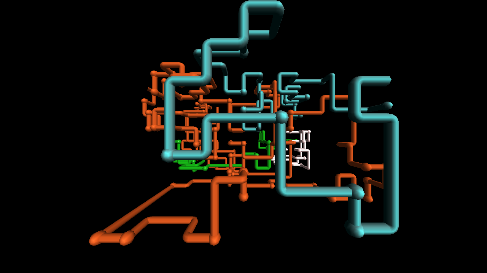

# pipes-scr-remake — 3D Pipes

A faithful recreation of the classic Windows "3D Pipes" screensaver
(`sspipes.scr`, Windows NT 4 through XP), written as a single C file using
Win32 and fixed-function OpenGL 1.1 — the same technology as the original.



> [!NOTE]
> **AI-generated code.** This project was written by AI — Anthropic's
> **Claude (model: Claude Fable 5)** running in Claude Code — from the prompt
> "replicate the look and feel of the old Windows pipes screensaver".
> The visual output was verified against the original by rendering test
> frames, but the code has not been line-by-line reviewed by a human.
> Later work (the test suite and the features added after the first
> release) was done by **Claude Opus 5.5**, also in Claude Code.

## What it replicates

- Pipes grow stepwise through a 3D grid aligned with the view, in a
  perspective volume against a black void.
- Glossy, smooth-shaded pipes in random bright colors (one directional
  light, strong specular highlight).
- **Joints** in the original's four styles: elbows (quarter-torus bends),
  balls (the big bulging sphere), mixed (about one turn in three gets a
  ball) and cycle (elbows, then balls, then mixed, changing every scene).
- Sphere caps where a pipe starts and where it ends.
- The original's growth rules: each pipe has its own taste for going
  straight (most turn often, about one in twenty is a "long runner" that
  only turns when it must), and a pipe runs until it boxes itself in.
- **Single** mode grows one pipe at a time, five per scene. **Multiple**
  mode starts two to four at once and draws seven per scene; about one
  multiple-pipe scene in five becomes a **chase**, where the other pipes
  follow a lead pipe around, and (as in the original) once a chase has
  happened every later scene is a chase too.
- When a scene's pipes are used up, the finished picture is eaten by
  **small black squares in random order** (the original's "digital
  dissolve"), and the next scene is viewed from a little further round
  (9.73° per scene).
- **Multi-monitor**: fullscreen mode covers the entire virtual desktop and
  runs an independent pipes scene on every monitor (an improvement over the
  original, which left secondary monitors showing the desktop). Input on
  any monitor dismisses it.

## Build

Requires any MinGW-w64 gcc (e.g. [MSYS2](https://www.msys2.org/) ucrt64).
No libraries beyond what ships with Windows (`opengl32`, `gdi32`, `user32`).

```powershell
.\build.ps1
```

or directly:

```
gcc -O2 -Wall -Wextra -o pipes.exe pipes.c -lopengl32 -lgdi32 -luser32 -mwindows
```

MSVC works too: `cl /O2 pipes.c /link opengl32.lib gdi32.lib user32.lib /subsystem:windows`

## Run

| Command | Behavior |
|---|---|
| `pipes.exe` | Windowed (1280x720), Esc to quit |
| `pipes.exe /s` | Fullscreen on all monitors — any key, click, or mouse movement exits |
| `pipes.exe /c` | Screensaver "configure" stub |
| `pipes.exe /shot out.bmp [steps] [seed]` | Simulate N growth steps, render one 1280x720 frame to a BMP, exit (used for visual testing; a seed makes the picture reproducible) |

## Tests

```powershell
.\build.ps1 -Test
```

builds the program and the test suite (`tests/test_pipes.c`) with warnings
treated as errors, then runs every test. The suite checks the command line,
how pipes grow and join, the scene lifecycle, multi-monitor layout and
screenshots, and it launches `pipes.exe` itself to check the windowed
viewer, the fullscreen screensaver, `/c` and `/p`. Each test prints as a plain
sentence:

```
Growing pipes
  PASS  a pipe never moves into a node that is already taken
  PASS  pipes never leave the grid
```

Rendered pictures are kept in `test-output/`. The same suite runs on GitHub
Actions (Windows) for every pull request.

## Install as an actual screensaver (.scr)

A Windows screensaver is just an executable renamed to `.scr` that handles
the `/s`, `/c`, and `/p` arguments — which this program does.

1. Build, then rename:

   ```powershell
   Copy-Item pipes.exe pipes.scr
   ```

2. Either right-click `pipes.scr` in Explorer and choose **Install**, or copy
   it to `C:\Windows\System32` (needs admin) and it will appear in
   **Settings → Personalization → Lock screen → Screen saver settings**
   under the name "pipes".

## Missing features / future work

Compared to the original `sspipes.scr`, the following are not (yet)
implemented:

- **The teapot easter egg** — the original very rarely rendered a Utah
  teapot in place of a joint. Needs the teapot Bezier patch data.
- **Configuration dialog** — the original let you choose pipe count
  (single/multiple), joint style (elbow/ball/mixed/cycle), surface style
  (solid/textured), speed and resolution. Here those are compile-time
  settings in `pipes.c` (`multiplePipes`, `jointStyleSetting`, `STEP_MS`,
  …) and `/c` just shows a message box.
- **Preview pane mode** — `/p <hwnd>` (the little preview inside the
  screensaver settings dialog) exits cleanly instead of rendering.
- **Textured pipes** — the original's optional marble/texture surface mode.

## Tuning

All the knobs are constants at the top of [pipes.c](pipes.c): pipe radius,
elbow/ball radii, growth speed (`STEP_MS`), pipes per scene
(`NORMAL_PIPES_PER_SCENE`, `MULTIPLE_PIPES_FACTOR`), straight-run weights,
the ball share of mixed joints, the chase odds, the dissolve
(`DISSOLVE_MS`, square size) and the per-scene turn. Single/multiple pipes
and the joint style are `multiplePipes` and `jointStyleSetting` (Single and
Elbow by default, as in the original) until the settings dialog arrives.
